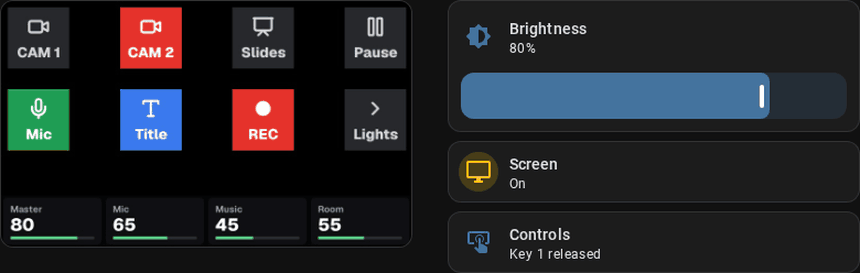

  

<h1 align="center">DeckConnector</h1>

  Your Stream Deck on the network. A small ESP32-P4 board drives it over USB, 
  and Bitfocus Companion and the Elgato App use it like an Elgato Network Dock.

  <a href="https://deckconnector.com"><b>Website</b></a> ·
  <a href="https://deckconnector.com/demo">Live demo</a> ·
  <a href="https://deckconnector.com/flash">Flash in the browser</a> ·
  <a href="https://deckconnector.com/docs">Docs</a>

  

- Companion connects over Satellite or as a Network Dock. The Elgato App sees a Network Dock.
- Several programs connect at once. You pick the one that draws.
- Several decks on one connector.
- Wi-Fi with a backup network, Ethernet, and power over PoE.
- Home Assistant gets every key press, sets the brightness and turns the screen off.
- Apple Home and Google Home with the Matter firmware.
- A web UI with the live deck, where you can also press keys.
- Log in with a passkey, or confirm the login on the deck.

  

## Get started

1. Get a [Waveshare ESP32-P4-WIFI6-POE-ETH](https://deckconnector.com/docs/hardware) board.
2. [Flash it in the browser](https://deckconnector.com/flash). There is nothing to install.
3. Plug in the deck and open the address it shows. The setup wizard does the rest.

Everything else is in the [docs](https://deckconnector.com/docs). To build it yourself or to help, see [CONTRIBUTING](.github/CONTRIBUTING.md).

## License

[AGPL-3.0](LICENSE), with an [exception for Remotion](https://deckconnector.com/docs/license). Third-party notices are in [THIRD_PARTY_LICENSES.txt](THIRD_PARTY_LICENSES.txt).

DeckConnector is not affiliated with Elgato or Corsair. Elgato and Stream Deck are trademarks of Corsair Memory, Inc.
