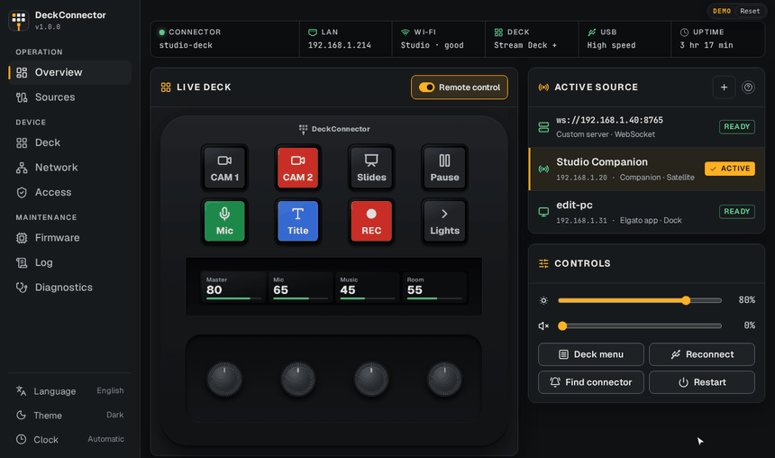
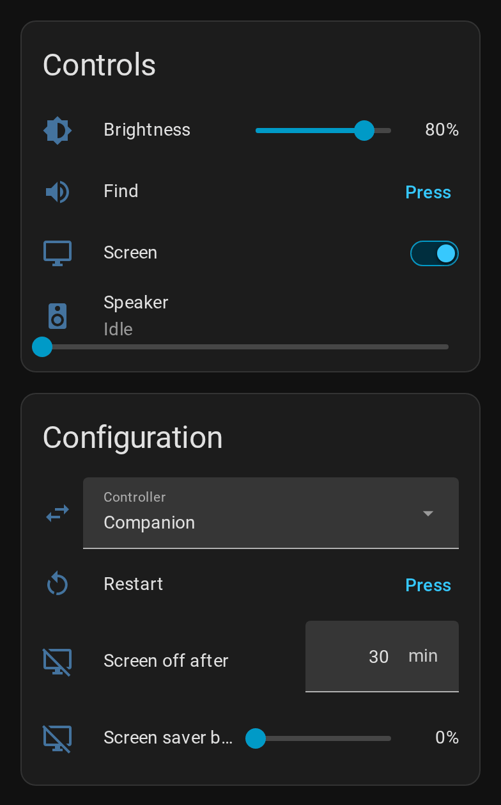
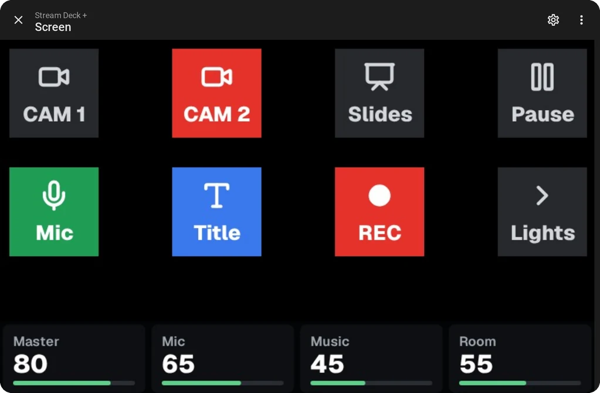
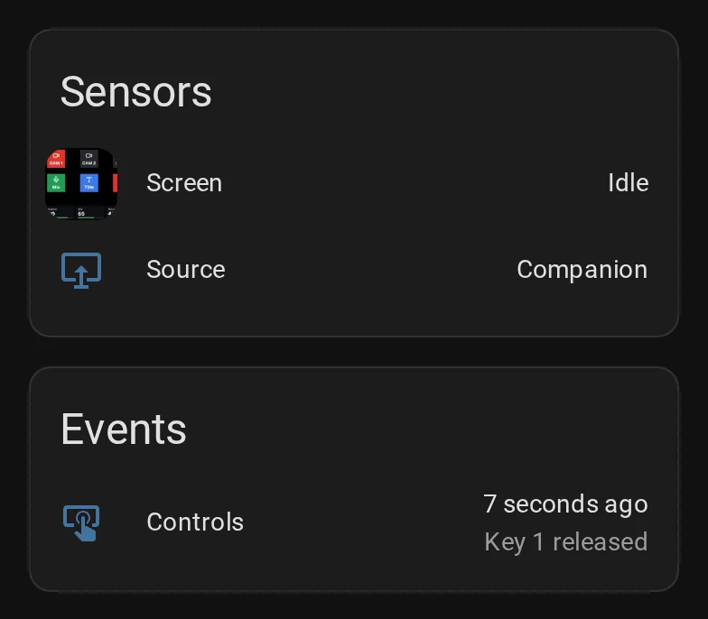

  

<h1 align="center">DeckConnector</h1>

  Your Stream Deck on the network. A small ESP32-P4 board drives it over USB, 
  and Bitfocus Companion and the Elgato App use it like an Elgato Network Dock.

  <a href="https://deckconnector.com"><b>Website</b></a> ·
  <a href="https://deckconnector.com/demo">Live demo</a> ·
  <a href="https://deckconnector.com/flash">Flash in the browser</a> ·
  <a href="https://deckconnector.com/docs">Docs</a>

  

<table align="center">
  <tr>
    <th colspan="2">Home Assistant</th>
  </tr>
  <tr>
    <td valign="top"></td>
    <td valign="top"> </td>
  </tr>
  <tr>
    <td colspan="2" align="center"></td>
  </tr>
</table>

- Companion connects over Satellite or as a Network Dock. The Elgato App sees a Network Dock.
- Several programs connect at once. You pick the one that draws.
- Several decks on one connector.
- Ethernet with PoE, and Wi-Fi with a backup network.
- Home Assistant gets every key press and the deck picture. It sets the brightness and the volume, and picks the program that draws.
- Matter, tested with Home Assistant and Apple Home.
- The web UI shows the live deck, and you can press its keys.
- Log in with a passkey, or confirm the login on the deck.

## Get started

1. Get a [Waveshare ESP32-P4-WIFI6-POE-ETH](https://deckconnector.com/docs/hardware) board.
2. [Flash it in the browser](https://deckconnector.com/flash). There is nothing to install.
3. Plug in the deck and open the address it shows. The setup wizard does the rest.

Everything else is in the [docs](https://deckconnector.com/docs). To build it yourself or to help, see [CONTRIBUTING](.github/CONTRIBUTING.md).

## License

[AGPL-3.0](LICENSE). Warranty, trademarks and an added permission are in [NOTICE.md](NOTICE.md).

Support DeckConnector on [GitHub Sponsors](https://github.com/sponsors/FusselTV) or [Ko-fi](https://ko-fi.com/fusseltv).
